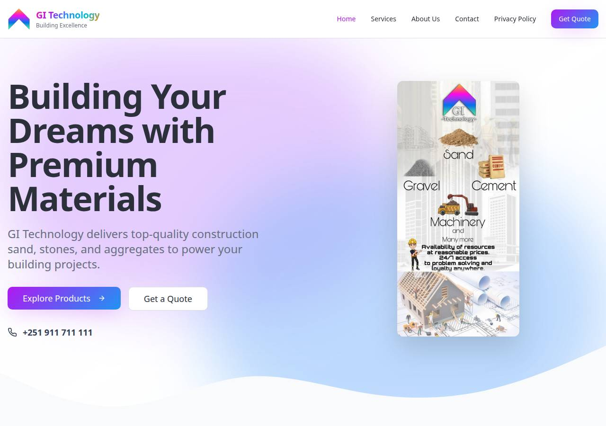

# Local website journey evidence

GI Technology is a React 18 / TypeScript website built with Vite 5, Tailwind CSS,
and shadcn/ui. These checks demonstrate the existing frontend journey, not live
business operation or customer impact.

## Run the checks

Use Node.js 22 or 24 and npm from the repository root:

```sh
npm ci
npx --no-install playwright install chromium --only-shell
npm run test:browser
```

The pinned Playwright runner builds the production bundle, starts its own Vite
preview at `http://127.0.0.1:3012`, and stops it when finished. No credentials or
environment file are needed. Port 3012 must be free: the runner will not reuse a
server or silently switch ports. Stop your own development preview first.
On minimal Linux hosts, Playwright may require system browser libraries; follow
its missing-library diagnostic under your usual system package policy.

[`playwright.config.ts`](../playwright.config.ts) runs four scenarios at each of
two Chromium viewports: desktop **1280 x 900** and mobile-width **390 x 844**.
The mobile project is viewport coverage, not a physical-device test.

## What is asserted

The assertions live in [`tests/website-journey.spec.ts`](../tests/website-journey.spec.ts).

| Scenario | Evidence |
| --- | --- |
| Home to products to contact | The real title and hero image load; native Tab/Shift+Tab/Enter reaches Explore Products, `/services`, Request Quote, and `/contact`. Hero CTAs remain fully in view when focused. Links are single controls, not nested buttons. |
| Navigation | Menu destinations and current-page state are exposed. On mobile, Enter/Space opens the disclosure, Tab reaches links, Escape closes it and restores focus, and route navigation closes it. |
| Product availability controls | The two available products expose quote links. The two coming-soon controls are disabled buttons without navigable link wrappers and are skipped by Tab. |
| Contact controls | Labels and native keyboard order work; empty-name and invalid-email submission trigger browser validation. Valid synthetic input produces a not-sent notice and remains in the form. Existing phone/email destinations are checked without activation. |

Every scenario also fails on a console error, uncaught page error, or HTTP error.
No retry is configured to conceal an intermittent failure.

The UI fixes preserve the existing palette, layout, photography, and business
copy. They use the existing Button `asChild` pattern for navigation, expose
mobile-menu state/focus behavior, and replace the form's former false success
and text-clearing behavior with an explicit delivery limitation.

## Safety boundary and limitations

Browser requests are allowed only to the test server's exact loopback origin,
using GET or HEAD. Other origins and mutation methods are aborted and recorded
as test failures; service workers are blocked. No endpoint returns a fabricated
success response, and no backend is mocked.

The form has **no delivery backend**. The suite uses synthetic text and
`reviewer@example.test`, never opens `mailto:` or `tel:` destinations, and does
not submit anything to the deployed website. A passing run does not prove
email/phone delivery, quote fulfillment, availability of materials, or any other
business operation.

This is not a comprehensive accessibility audit, visual regression suite,
cross-browser/device certification, or performance measurement. About/privacy
content, map integration, live deployment routing, real communications, and
backend behavior are outside the tested journey. No traffic, revenue, conversion,
Lighthouse, or accessibility score is inferred.

## Local screenshot



This 1280 x 900 JPEG is captured from the actual local homepage using the
repository's existing assets, not a mockup. It provides visual context only; the
behavior assertions above are the evidence. The desktop journey writes a fresh
`home-desktop.jpg` under `test-results/` on each run. To refresh this documentation
image, run the desktop journey, review the generated image, then copy it here:

```sh
npm run test:browser -- --project=desktop --grep "home to products"
```

Failure screenshots and traces also stay in ignored `test-results/`; they are
not uploaded anywhere.

## Other checks and existing baseline

`npm run build` produces the production bundle. `npm run lint` currently reports
three pre-existing errors: empty interfaces in `src/components/ui/command.tsx`
and `src/components/ui/textarea.tsx`, and a `require()` import in
`tailwind.config.ts`, plus seven Fast Refresh warnings. These are not suppressed
or expanded into an unrelated cleanup.

The locked TypeScript is 5.8.3, but the existing app configuration specifies
`ignoreDeprecations: "6.0"`, so a plain app type-check fails with TS5103. The
explicit compatible override below checks app types without changing that
configuration. Changed journey code and browser tooling are also linted and
type-checked separately; this is not a claim that all repository-wide checks pass.

```sh
npx --no-install tsc --project tsconfig.app.json --noEmit --ignoreDeprecations 5.0
npx --no-install tsc --project tsconfig.node.json --noEmit
```
